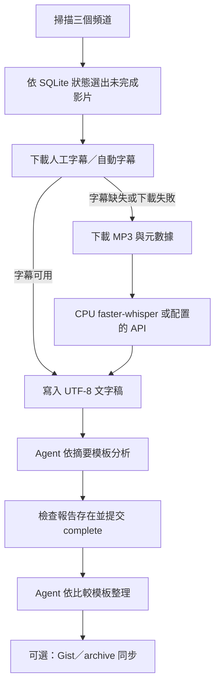

# CUI Member Skill

本專案提供 YouTube 影片掃描、字幕優先文字稿、音訊轉錄與 AI 分析工作流，預設處理 **[小翠時政財經](https://www.youtube.com/@cui_news)**、**[美投侃新聞](https://www.youtube.com/@MeiTouNews)** 與 **[美投講美股](https://www.youtube.com/@MeiTouJun)** 三個頻道；完成摘要後可選擇產生觀點比較並歸檔。

## 專案設計理念

- **AI Agent 優先 (Agent-centric)**：功能被封裝為一系列的 Scripts (Skills)，設計初衷是交由 AI Agent 閱讀 `AGENTS.md` 後自動呼叫與執行，而非完全依賴人類手動輸入指令。
- **環境隔離**：使用 `uv run` 執行腳本；需要外部 Python 套件的腳本以內嵌依賴宣告供 `uv` 管理。
- **跨平台轉譯**：Windows/Linux 原生本地模式採 CPU faster-whisper；Apple Silicon 可選擇 MLX，也可設定 OpenAI/Azure API。

---

## 斜線指令（Slash Commands）一覽

將以下指令直接貼給 AI Agent（如本聊天視窗），Agent 將自動完成對應步驟。

| 指令 | 功能 | 必要輸入 |
|------|------|----------|
| `/scan_cui` | 掃描小翠時政財經待處理影片 | （無） |
| `/scan_meitou` | 掃描美投侃新聞與美投講美股待處理影片 | （無） |
| `/process` | 掃描預設三頻道並逐支字幕優先處理，然後依模板分析 | （無） |
| `/download <YouTube URL>` | 下載 MP3 與元數據（僅字幕不可用時需要） | YouTube URL |
| `/organize` | 分類影片並建立 Windows 安全且唯一的資料夾 | 影片資訊 |
| `/transcribe <mp3路徑>` | 本地或雲端語音轉文字 | `.mp3` 檔案路徑 |
| `/summarize <txt路徑>` | 依摘要模板輸出繁體中文報告 | `.txt` 檔案路徑 |
| `/compare` | 依比較模板整理可用摘要 | （無） |
| `/sync` | 選擇性同步至 GitHub Gist | （無） |
| `/archive` | 選擇性同步至 `./archive` Git 專案 | （無） |

---

## 🛠️ 技術工作流與生成方式

`/process` 掃描三個頻道。字幕／音訊／轉錄階段可恢復；文字稿就緒不代表已完成。只有報告存在並提交狀態後才標記 complete。分析、比較與同步由 Agent 按指引執行，Gist/archive 同步為選擇性步驟。



---

## 前置需求與原生安裝（Windows / Linux）

主要工作流程可直接在 Windows 或 Linux 原生執行，CPU 本地轉譯為預設基線；不需要 Docker。請安裝並加入 PATH：

- `uv`：Python 指令與各腳本的內嵌依賴管理器。
- `yt-dlp` 需要的 JavaScript runtime `node`。
- `ffmpeg`：音訊擷取／轉換；大型雲端轉譯輸入也可能使用此工具壓縮音訊。

腳本以 PEP 723 內嵌依賴透過 `uv run` 執行；本 repository 沒有 `pyproject.toml` 或 `uv.lock`，請勿執行 `uv sync`。

```powershell
Copy-Item .env.example .env
uv run skills/list_new_videos.py
```

```bash
cp .env.example .env
uv run skills/list_new_videos.py
```

會員影片可在 `.env` 指定專案根目錄下的 `COOKIES_PATH`（預設 `./cookies.txt`），或設定 `COOKIES_BROWSER` 從本機瀏覽器讀取。Cookies 含登入憑證，切勿提交至版本控制。相對路徑皆以 repository 根目錄解析，路徑可包含空格與 Unicode。

`WHISPER_MODE=local` 在 Windows/Linux 使用 CPU `faster-whisper`（medium、int8）；Apple Silicon macOS 可使用 MLX。GPU 與 Docker Compose 為選擇性部署方式，並非原生流程必要條件。OpenAI/Azure 模式需另外設定對應 API 變數。

## 使用方法 (Workflow)

**最推薦使用 `/process`**。它掃描三個預設頻道：「小翠時政財經」、「美投侃新聞」、「美投講美股」。只有摘要存在並明確提交完成狀態的影片才會從後續掃描排除。字幕優先，字幕不可用時才下載 MP3 並以 Whisper 轉錄。

### 原生手動執行

```bash
# 掃描三個頻道中尚未完成處理的影片
uv run skills/list_new_videos.py --format json

# 為掃描結果中的每支影片執行可恢復處理流程
uv run skills/process_video.py "https://www.youtube.com/watch?v=VIDEO_ID" --video-id VIDEO_ID --title "影片標題" --channel-key CHANNEL_KEY
```

`process_video.py` 會解析分類與日期，建立安全資料夾，先取得最佳可用字幕並產生 UTF-8 `.txt`；只有字幕下載失敗或沒有可用字幕時，才下載 `.mp3` 並呼叫 `transcribe.py`。文字稿完成標記為 `transcript_ready`，摘要報告建立後還須執行：

```bash
uv run skills/process_video.py "https://www.youtube.com/watch?v=VIDEO_ID" --video-id VIDEO_ID --title "影片標題" --channel-key CHANNEL_KEY --mark-summarized
```

此命令確認 `.txt` 與安全資料夾同名 `.md` 報告都存在後才標記 `complete`；若摘要中斷，下一次掃描仍會列出該影片，摘要重試不會重複下載或轉錄。字幕錯誤保留於 `logs/video_state.sqlite3`。
報告檔名使用完整安全資料夾名稱加 `.md`；標題及 Windows 禁用字元由目錄解析器安全化，影片 ID 作為唯一後綴。分析與比較模板位於 `skills/templates/summarize_template.md`、`skills/templates/compare_template.md`。

處理完畢後，可選擇執行現有同步工具：

```bash
uv run skills/sync_gist.py
uv run skills/sync_archive.py
```

Gist 同步需在 `.env` 設定有效的 `GITHUB_TOKEN` 與 `GIST_ID`；未設定時依腳本行為略過。

---

## 專案結構

```
cui-member-skill/
├── AGENTS.md
├── README.md
├── .env.example
├── docker-compose*.yml          # 選用容器設定
├── skills/
│   ├── process_video.py          # 字幕優先、可恢復的單影片流程
│   ├── subtitle_to_text.py       # 字幕下載與 VTT 轉文字
│   ├── download_audio.py
│   ├── transcribe.py
│   ├── resolve_target_dir.py
│   ├── list_new_videos.py
│   ├── video_state.py            # SQLite 階段狀態
│   ├── path_utils.py             # 安全檔名與專案路徑
│   ├── templates/
│   └── prompts/process.prompt.md
├── tests/
└── docs/                         # 摘要、文字稿與其他輸出
```

## License

This project is licensed under the MIT License - see the [LICENSE](LICENSE) file for details.
